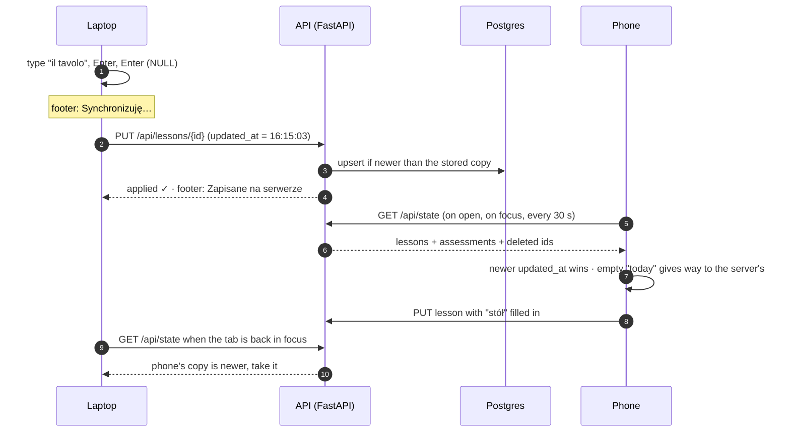

<picture>
  <source media="(prefers-color-scheme: dark)" srcset="./docs/assets/header-dark.svg">
  <source media="(prefers-color-scheme: light)" srcset="./docs/assets/header-light.svg">
  
</picture>

<p align="center">
  <a href="https://github.com/igorkotlarz1/quaderno/actions/workflows/ci.yml"></a>
  
  
  
</p>

<p align="center">
  
  
  
  
  
  
  
  
  
  <br>
  
  
  
  
  
  
  
  
  
</p>

<p align="center"><i>„Chi va piano va sano e va lontano.”</i> · slow and steady goes far, one lesson at a time.</p>

---


**Quadernote** is *quaderno* (Italian for *notebook*) plus *note*, with the accent on the last *è* that every Italian learner keeps forgetting to type. It is my personal app for learning Italian. During a one-hour conversation lesson I type Italian → Polish pairs as fast as I can, leave gaps when I don't know the translation, and drop in the verbs we used. After the lesson an LLM fills the gaps, fixes the accents and checks the verb forms the app isn't sure about. Every week it estimates my CEFR level on the way from A1 to B1.

It is also my testbed for a bigger idea: an AI tutoring platform. Everything here (sync, LLM calls with cost logging, OCR of a paper notebook, pronunciation scoring) is built small, on a real learner (me), before it goes anywhere near other people.

<details>
<summary><b>Contents</b></summary>

- [Come si usa: how to use it](#%EF%B8%8F-come-si-usa-how-to-use-it)
- [Use cases](#-use-cases)
- [Under the hood: architecture](#%EF%B8%8F-under-the-hood-architecture)
- [Milestones](#-milestones)
- [Run it yourself](#-run-it-yourself)
- [Repository rules](#-repository-rules)

</details>

## ✍️ Come si usa: how to use it

The interface is in Polish (that's my native language); the labels below are quoted as they appear, with a translation.

### 1 · During the lesson: just type

Open the app. Today's lesson is already there, dated in Italian at the top (*giovedì 19 novembre*).

| You press | What happens |
|---|---|
| type Italian, <kbd>Enter</kbd> | jump to the Polish field |
| type Polish, <kbd>Enter</kbd> | new row, caret back on Italian |
| <kbd>Enter</kbd> on an empty Polish field | saved as **NULL** (red *brak tłumaczenia*, "no translation yet"); the AI fills it later |
| <kbd>↑</kbd> <kbd>↓</kbd> | move between rows |
| <kbd>Backspace</kbd> on an empty row | delete the row |
| <kbd>e</kbd> then <kbd>`</kbd> | becomes **è** while you type (works for à è é ì ò ù) |
| accent bar under the sheet | one tap for à è é ì ò ù È À if your keyboard has none |

Rows are tagged automatically as *słowo* (word) or *zdanie* (phrase/sentence); one click switches it. Nothing to save: every keystroke is stored on the device, also without a network. Install it from the browser menu (*Zainstaluj aplikację* / *Do ekranu początkowego*) and it opens like an app, in airplane mode too.

### 2 · Verbs: hidden forms you reveal yourself

Type an infinitive into **Czasowniki** (verbs), e.g. `parlare`. You get a *presente* table for io / tu / lui·lei / noi / voi / loro with the forms **covered**. Say the form out loud, click to check it. What you revealed stays revealed.

The app conjugates regular -are / -ere / -ire verbs (including -isc-, -care/-gare, -iare, reflexive -rsi) and about 40 common irregular ones by itself. Anything it isn't sure about is marked *do sprawdzenia* (to check) and goes to the AI. The rest never costs a token.

### 3 · After the lesson: the dictionary first, then the AI

Under every row without a translation the app shows up to three Polish meanings from its **offline dictionary** (M3.5): `le finestre` → **okno**. Nothing is filled in until you tap one, because many words have several meanings. **Słownik offline → Uzupełnij ze słownika** fills all the NULLs it knows with the most common meaning in one go, marked `pl_source: "dict"` and underlined with dots. It works in airplane mode and costs nothing. How the dictionary is made and whose work it is: [📚 The offline dictionary](#-the-offline-dictionary-data-method-credits).

What the dictionary does not know goes to the AI. Open **Uzupełnij z Claude** (fill in with Claude) → **Opracuj lekcję** (work through the lesson). One click: the server sends the lesson to the Claude API and the answer lands in the rows. Claude:

- fills the NULLs,
- fixes accents (`caffe'` → `caffè`; the old spelling stays visible as a dotted underline),
- adds part of speech and lemma,
- conjugates only the verbs marked *do sprawdzenia*.

Only what changes is applied: a word you corrected while Claude was working stays yours. Every call is logged with model, tokens and estimated cost, visible under **Koszty Claude** (expected: about a grosz or less per lesson on Claude Haiku 5.5; the log shows the real number). The API key lives only on the server (`ANTHROPIC_API_KEY` in `.env`); without it the app falls back to the manual flow: copy the prompt, paste Claude's JSON answer into **Eksport i import**.

### 4 · Every week: where am I?

The vial at the top shows the level **A1 · A1+ · A2 · A2+ · B1** and how far I am to the next one. Once a week the app asks for an assessment (**Ocena tygodnia**). The model gets the last 7 days of words, verbs and my own notes. It answers with a level, a progress score, what I can do already (*Umiesz już*), what to fix (*Do poprawy*) and a plan for next week (*Plan na tydzień*).

### 5 · Phone and laptop, same notebook

With the server running (M2), open the same address on the phone. Today's lesson is there. The footer says **Zapisane na serwerze 16:15** (saved on the server). Fill a NULL on the phone on the bus, and the laptop has it the next time you look.

### 6 · Every day: Powtórka (spaced repetition)

At the top of the page, **Powtórka** says what is on for today: cards due for review and a few new ones (10 a day by default). Every word with a translation becomes two cards: *la casa → ?* (flip and rate yourself: **Znowu · Trudne · Dobrze · Łatwe**) and *dom → ?* (type the Italian; a missing accent counts as "almost"). A checked verb asks one form at a time: *andare, noi → ?*. The schedule comes from [FSRS](https://github.com/open-spaced-repetition/ts-fsrs) (the algorithm modern Anki uses, MIT license), computed on the phone from the log of answers, so it works in airplane mode and phone and laptop agree once they sync.

### Also in the toolbox

- **Wklej stare notatki** (paste old notes): paste lines like `la casa – dom` from an old notebook and they become rows.
- **Eksport i import**: a JSON export of everything (schema version 1) to back up or move between devices.

## 📚 The offline dictionary: data, method, credits

Most Italian you hear in conversation is a small set of words: in the subtitle corpus below, the **1,000 most frequent lemmas cover about 86 % of all running words, and 5,000 cover about 94 %** (measured on the frequency list with Morph-it! lemmas; an upper bound, since not every lemma has a Polish entry yet). So instead of asking an LLM to translate *finestra* for the hundredth time, the server keeps an Italian→Polish dictionary built from open data, and the phone keeps the top 5,000 lemmas for offline use. The LLM only sees what the dictionary does not know.

**No dataset is stored in this repository.** `python -m app.lexicon.build` downloads the files on the server, checks their SHA-256 (pinned for the files that never change), and loads the result into Postgres (`lex_lemmas`, `lex_forms`, `lex_meta`). The hash of every file used is kept in `lex_meta`, so each build can be traced back to its exact sources.

### Sources and licenses

| Data set | What we take from it | Authors | License |
|---|---|---|---|
| [FrequencyWords](https://github.com/hermitdave/FrequencyWords), Italian 50k (2018) | how often each word form is used in spoken Italian (film and TV subtitles) | Hermit Dave; built from the [OpenSubtitles](https://www.opensubtitles.org) 2018 corpus as published by [OPUS](https://opus.nlpl.eu) (P. Lison, J. Tiedemann, *OpenSubtitles2016*, LREC 2016) | [CC BY-SA 4.0](https://creativecommons.org/licenses/by-sa/4.0/) |
| [Morph-it!](https://docs.sslmit.unibo.it/doku.php?id=resources:morph-it) 0.4.8 | which dictionary form an inflected form belongs to (*finestre* → *finestra*, *parlo* → *parlare*) | Marco Baroni, Eros Zanchetta (SSLMIT, University of Bologna) | [CC BY-SA 2.0](https://creativecommons.org/licenses/by-sa/2.0/) / LGPL |
| [Wikisłownik](https://pl.wiktionary.org) (Polish Wiktionary), Italian entries, via [kaikki.org](https://kaikki.org/plwiktionary/) | the Polish meanings of each Italian word, in Wiktionary's order | Wikisłownik contributors; extracted with [wiktextract](https://github.com/tatuylonen/wiktextract) by Tatu Ylonen (*Wiktextract: Wiktionary as Machine-Readable Structured Data*, LREC 2022) | [CC BY-SA 4.0](https://creativecommons.org/licenses/by-sa/4.0/) and GFDL |

The same list, with links, is shown in the app under **Słownik offline → Źródła słownika** (it comes from the server together with the data). Thank you to all of them: this feature exists because they published their work openly.

### Method

1. **Meanings** come from Wikisłownik only: Italian entries (`lang_code = it`) with at least one Polish gloss. Up to 6 senses per part of speech, in the order the entry lists them. Qualifiers like *(rysunek)* become a note, footnote marks are dropped, and pure cross-references (*zob. …*) are skipped. Entries that only say "a form of X" are used to link forms, not as meanings.
2. **Forms → lemma.** Every word form is linked to its lemma(s) from Morph-it! and from Wikisłownik's "form of" entries; a lemma always counts as its own form. Lemmas with no Polish meaning are left out.
3. **Frequency.** Each form's count from the subtitle list goes to its lemma. A form that belongs to several lemmas (*sono* = *essere* or *sonare*) is split in proportion to how often those lemmas occur on their own, so *essere* gets almost all of it.
4. **Rank.** Lemmas are sorted by that frequency. The phone downloads the top 5,000 (with only the forms that actually occur in the corpus) and keeps them in IndexedDB; the server answers `/api/lexicon/lookup` for everything else.
5. **Lookup.** What you typed is lower-cased, the article is removed (*la*, *gli*, *l'*, *un'* …) and the form is looked up exactly, then without accents (*citta* → *città*). Suggestions are ordered by lemma frequency.

### Honest limits

- The dictionary does not read context: for *sono* it offers *być* first, even in *sono le tre* or a sentence about bells. That is why it only **suggests**, and why every filled-in translation is marked `pl_source: "dict"` and can be changed.
- Glosses are copied as Wikisłownik writes them, so some are long (*cześć!, serwus!, witaj!; do zobaczenia!*) and a few may be wrong or missing. Corrections belong upstream, in Wikisłownik, where they help everyone.
- Subtitles over-represent spoken, informal Italian. For a beginner in conversation classes that is a feature.
- Whole phrases are not in the dictionary; they go to the LLM.
- The built dictionary is a derivative of CC BY-SA data, so if it is ever shared with others (M8), it stays under CC BY-SA with these credits.

## 🎯 Use cases

| Who / when | What Quadernote does |
|---|---|
| **In a live lesson**, the teacher is talking fast | Two keys per word (<kbd>Enter</kbd> <kbd>Enter</kbd>), no mouse, no thinking about missing translations |
| **On the bus after class** | Phone: fill the NULLs, reveal the verb forms you just learned, repeat out loud |
| **Sunday evening** | Weekly level check: one prompt, one JSON, the vial moves (or doesn't, honestly) |
| **An old paper notebook** | Paste the old notes now; from M6, take a photo of the page instead |
| **"Did I already learn *finestra*?"** | One place for every lesson; semantic search ("words about the house") in M8 |
| **A word you met for the 50th time** | The offline dictionary suggests *okno* for *le finestre*; no API call, no cost |
| **The server is off** | The app keeps working on the device and syncs when the server is back |
| **Another learner** (my next step) | The same pipeline is the seed of a tutoring platform: lesson capture → LLM cleanup → spaced repetition → progress reports for parents and tutors |

## 🏛️ Under the hood: architecture

<picture>
  <source media="(prefers-color-scheme: dark)" srcset="./docs/assets/architecture-dark.svg">
  <source media="(prefers-color-scheme: light)" srcset="./docs/assets/architecture-light.svg">
  
</picture>

| Layer | Choice | Why |
|---|---|---|
| Frontend | React 19 + TypeScript + Vite | logic ported 1:1 from the original single-file app, now testable |
| State | one store object + `useSyncExternalStore`, saved to IndexedDB through Dexie, with a synchronous emergency copy when the page closes | typing must never wait for the network, and closing the app right after a word must not lose it |
| Offline | service worker (Workbox via `vite-plugin-pwa`) precaches the app; installable manifest | the app opens in airplane mode; edits wait in IndexedDB and go out when the network is back |
| API | FastAPI, Pydantic v2, SQLAlchemy 2, Alembic, run with `uv` | Python is my home turf; small, typed, no magic |
| Database | PostgreSQL 17 + pgvector, JSONB `extra` columns | relational core, flexible LLM fields, embeddings later without a second DB |
| Hosting | Dell OptiPlex 7050 Micro at home, Docker Compose, `restart: unless-stopped` | low power, on 24/7, no cloud bill |
| Network | port bound to `127.0.0.1`, exposed only through `tailscale serve` (HTTPS) | nothing open to the internet, no login screen to build yet |
| Backups | nightly `pg_dump` (14 kept) + restic → Backblaze B2, scripted trial restore | a backup counts only after a restore has worked |
| AI (M4+) | Claude: Haiku for cheap fixes, Sonnet for synthesis and weekly levels, Opus vision for notebook photos | every call logged with model, tokens and cost in `llm_calls` |

<details>
<summary><b>How sync works</b> (last write wins, per lesson)</summary>



- Deleting a lesson leaves a tombstone, so an old device cannot bring it back.
- Fields the server has no column for yet are kept in JSONB `extra`, so nothing an LLM adds is lost on a round trip.
- Without a server (or with `vite preview`) the sync layer stays silent and the app works like the single-file original.

</details>

<details>
<summary><b>Data model</b></summary>

```text
lessons      id · date · title · source · created_at · updated_at · deleted_at · summary · notes
  entries    id · lesson_id · position · it · pl (NULL = to fill) · kind · pl_source · pos · lemma
             · it_original · it_suggestion · extra (JSONB)
  verbs      id · lesson_id · position · it · pl · tense · forms (JSONB) · forms_source
             · confidence ("check" = ask the LLM) · revealed (JSONB) · extra
assessments  id · week_end · level · progress · assessed_at · data (JSONB, the whole report)
```

</details>

<details>
<summary><b>API</b></summary>

| Method | Path | What it does |
|---|---|---|
| `GET` | `/api/health` | `{"status": "ok"}` |
| `GET` | `/api/state` | all lessons, assessments and the ids deleted elsewhere |
| `PUT` | `/api/lessons/{id}` | upsert a whole lesson; an older copy is refused and the newer one returned |
| `DELETE` | `/api/lessons/{id}` | tombstone |
| `PUT` | `/api/assessments/{id}` | save a weekly level report |
| `GET` | `/` | the built React app (same origin, so one address on every device) |

</details>

<details>
<summary><b>Repository layout</b></summary>

```text
web/        React + TS app (src/lib: model, conjugation, level, prompts, store, sync)
server/     FastAPI app, SQLAlchemy models, Alembic migrations, pytest
scripts/    backup.sh · backup-loop.sh · restore-test.sh · restore.sh · readme_assets.py
backup/     image with pg_dump 17 + restic
legacy/     the original single-file app, used by the M1 gate test
docs/       ARCHITECTURE · MILESTONES · runbook/ (Polish, step by step) · log/ (what broke, per milestone)
compose.yaml · Dockerfile · .env.example
```

</details>

## 🪨 Milestones

<picture>
  <source media="(prefers-color-scheme: dark)" srcset="./docs/assets/milestones-dark.svg">
  <source media="(prefers-color-scheme: light)" srcset="./docs/assets/milestones-light.svg">
  
</picture>

Each milestone has a **gate**: one sentence that must be true on a real lesson, checked by an automated test (`test_gate_mN`) and by hand from a Polish runbook.

| | Milestone | Done when | Status |
|---|---|---|---|
| M1 | React + Vite + TS port | importing the old JSON export shows the same view as the original app | ✅ done |
| M2 | FastAPI + Postgres on the OptiPlex, Tailscale, backups | phone and laptop see the same lesson; a trial restore works | ✅ done |
| M3 | Offline-first PWA (IndexedDB + service worker) | a lesson typed in airplane mode syncs when the network is back | ✅ done |
| M3.5 | Offline Italian→Polish dictionary from open data | a top-5000 word typed in airplane mode gets a Polish suggestion without the API | ✅ done |
| M4 | "Opracuj lekcję" through the Claude API | one click instead of the manual prompt; cost of every call logged | ✅ done |
| M5 | Spaced repetition (FSRS) | the app picks what to review every day | 🟡 in review |
| M6 | Notebook OCR (vision) + review screen | photo of a page → checked words in the lesson | ⚪ |
| M7 | Voice: speech-to-text + pronunciation score | the app scores the pronunciation of a single word | ⚪ |
| M8 | Embeddings, semantic search, second user, PL ⇄ EN interface | search by meaning; a second user has separate data and an English UI | ⚪ |

Details and out-of-scope list: [docs/MILESTONES.md](docs/MILESTONES.md) · what broke and why: [docs/log](docs/log) · changelog: [CHANGELOG.md](CHANGELOG.md).

## 🚀 Run it yourself

**On a home server** (step by step, in Polish: [docs/runbook/m2.md](docs/runbook/m2.md)):

```bash
cp .env.example .env            # set POSTGRES_PASSWORD (e.g. openssl rand -hex 24); ANTHROPIC_API_KEY for one-click AI (M4)
docker compose up -d --build    # db (Postgres 17 + pgvector), api (FastAPI + the app), backup (nightly)
curl -s localhost:8000/api/health
docker compose exec api python -m app.lexicon.build   # downloads the open data sets and builds the dictionary
sudo tailscale serve --bg 8000  # HTTPS address inside your tailnet
```

**Development:**

```bash
# API (Python 3.12, uv)
cd server
uv sync
uv run pytest                   # SQLite by default; TEST_DATABASE_URL=postgresql+psycopg://... for Postgres
uv run uvicorn app.main:app --reload    # http://127.0.0.1:8000

# Web app (Node 22)
cd web
npm ci
npm run dev                     # http://localhost:5173, /api is proxied to :8000
npm test                        # unit tests (Vitest)
npm run e2e                     # gate M1 (Playwright, vite preview)
npm run e2e:server              # gates M2, M3, M3.5, M4, M5, against an EMPTY compose stack started with LLM_FAKE=true
                                # (first: docker compose exec api python -m app.lexicon.build --from tests/fixtures/lexicon)
```

The animated SVGs in this README are generated: `python3 scripts/readme_assets.py`. PWA icons: `cd web && node scripts/pwa-icons.mjs`.

The brand lives in [docs/assets/brand](docs/assets/brand): the app icon, the favicon-sized icon and the wordmark in light and dark. The wordmark is outlined from Archivo ExtraBold (SIL Open Font License), so it renders the same with or without web fonts; regenerate it with `python3 scripts/brand_assets.py <path to Archivo-ExtraBold.ttf>` (needs `fonttools`).

<p>
  &nbsp;&nbsp;
  <picture>
    <source media="(prefers-color-scheme: dark)" srcset="./docs/assets/brand/wordmark-dark.svg">
    
  </picture>
</p>

## 🔐 Repository rules

This repo is public on purpose (portfolio), so:

- secrets live only in `.env` (git-ignored); `.env.example` lists the keys with empty values,
- every diff is scanned for keys before a commit,
- real lesson data never enters the repo; tests use made-up words (*la finestra – okno*),
- the server port is never published beyond `127.0.0.1`.

Built milestone by milestone with [Claude Code](https://claude.com/claude-code) as a pair programmer.

<picture>
  <source media="(prefers-color-scheme: dark)" srcset="./docs/assets/footer-dark.svg">
  <source media="(prefers-color-scheme: light)" srcset="./docs/assets/footer-light.svg">
  
</picture>
